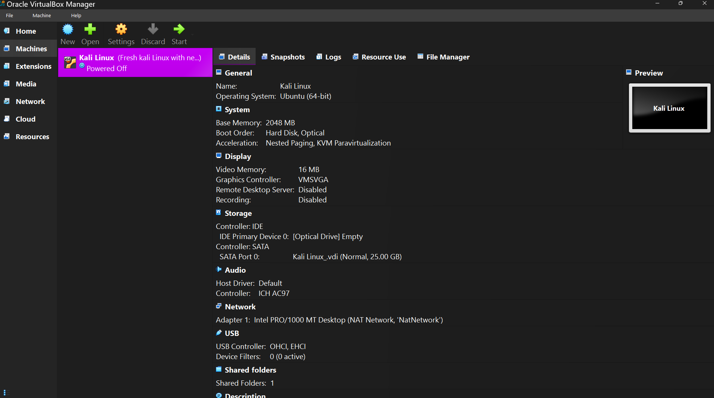
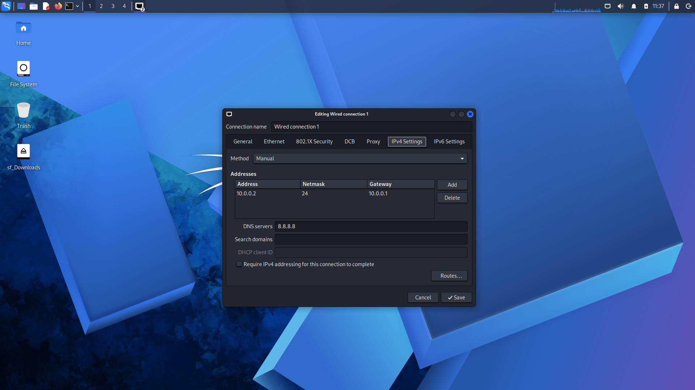
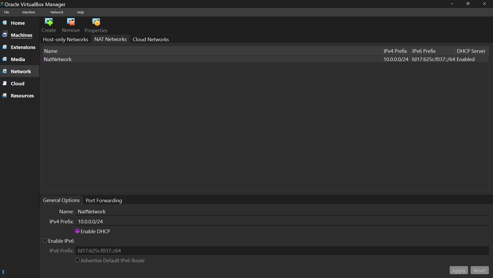
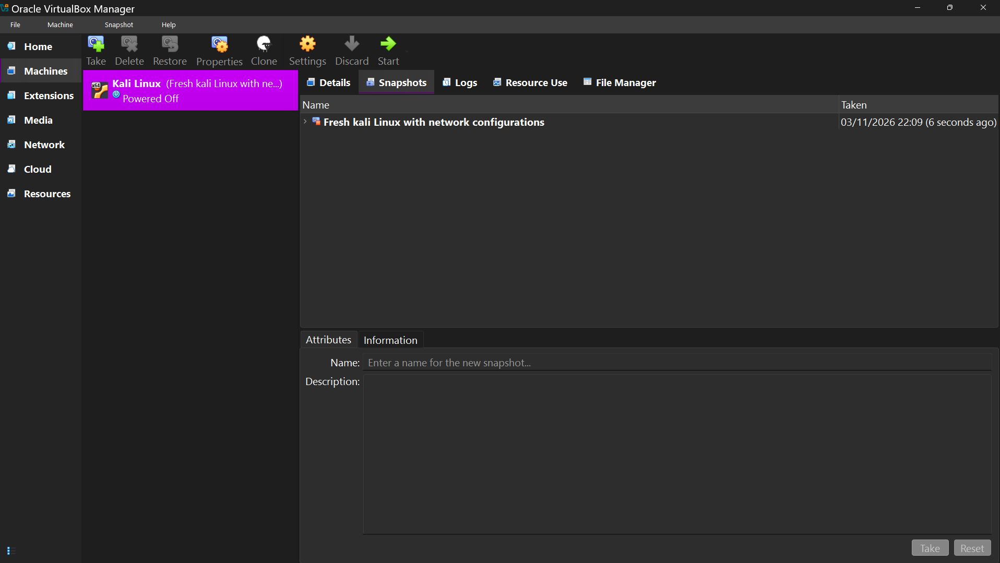

# Week 01 – Kali Linux Lab Setup

**Cybersecurity & Ethical Hacking Internship B084 | Networkwalks**

---

## 1. Project Overview

As part of Week 01 of my Cybersecurity and Ethical Hacking Internship at Networkwalks, I worked on setting up and configuring a Kali Linux virtual machine using Oracle VirtualBox.

The objective was to prepare a functional virtual lab environment for learning Linux, networking, and practical cybersecurity concepts. This setup will serve as the foundation for upcoming hands-on exercises throughout the internship.

## 2. Objectives

- Set up a Kali Linux virtual machine using Oracle VirtualBox.
- Understand basic virtualization concepts.
- Configure virtual machine hardware resources.
- Establish network connectivity using NAT Network.
- Assign a static IPv4 address.
- Create a virtual machine snapshot for recovery purposes.
- Prepare a working environment for future cybersecurity exercises.

## 3. Lab Environment

| Component | Configuration |
|---|---|
| Host Operating System | Windows |
| Virtualization Platform | Oracle VirtualBox |
| Guest Operating System | Kali Linux 2026.1 |
| System Type | Ubuntu (64-bit) |
| Allocated RAM | 2048 MB (2 GB) |
| CPU Cores | 1 |
| Virtual Disk | 25 GB |
| Network Adapter | Intel PRO/1000 MT Desktop |
| Network Mode | NAT Network |

## 4. Network Configuration

The virtual machine was connected through a NAT Network configured in Oracle VirtualBox.

### IPv4 Configuration

The following manual IPv4 settings were applied inside Kali Linux:

| Parameter | Value |
|---|---|
| IPv4 Method | Manual |
| IP Address | 10.0.0.2 |
| Subnet Mask | 255.255.255.0 |
| Default Gateway | 10.0.0.1 |
| DNS Server | 8.8.8.8 |
| Network Range | 10.0.0.0/24 |

### VirtualBox NAT Network

| Parameter | Value |
|---|---|
| Network Name | NatNetwork |
| IPv4 Prefix | 10.0.0.0/24 |
| DHCP Server | Enabled |

Internet connectivity was successfully established in the Kali Linux environment.

## 5. Implementation

The lab setup involved the following tasks:

1. Prepared a Kali Linux virtual machine in Oracle VirtualBox.
2. Configured the virtual machine with 2 GB RAM, 1 CPU core, and 25 GB of virtual storage.
3. Configured the network adapter to use NAT Network.
4. Set up manual IPv4 network configuration inside Kali Linux.
5. Configured the default gateway and DNS server.
6. Started the virtual machine and accessed the Kali Linux desktop environment.
7. Verified internet connectivity.
8. Created a VirtualBox snapshot to preserve the configured working state of the virtual machine.

## 6. Virtual Machine Snapshot

After completing the initial lab setup, I created a snapshot of the Kali Linux virtual machine using Oracle VirtualBox.

The purpose of this snapshot is to preserve the current working state of the virtual machine and provide a recovery point before performing further configurations or cybersecurity experiments.

**Why snapshots are useful:**

- Restore the virtual machine to a previous working state.
- Recover from configuration errors or unexpected changes.
- Experiment with different tools and settings more safely.
- Maintain a reliable starting point for future lab exercises.

This will help me maintain a consistent lab environment throughout the internship.

## 7. Screenshots

The following screenshots document the virtual machine and network configuration performed during the task.

### 7.1 Virtual Machine Configuration

### 7.2 Kali Linux IPv4 Configuration

### 7.3 VirtualBox NAT Network Configuration

### 7.4 VirtualBox Snapshot

## 8. Key Learnings

Through this task, I gained practical exposure to:

- Setting up and working with Kali Linux.
- Virtualization using Oracle VirtualBox.
- Allocating hardware resources to virtual machines.
- Understanding NAT networking.
- Configuring static IPv4 addresses.
- Understanding subnet masks, default gateways, and DNS.
- Creating and managing virtual machine snapshots.
- Preparing a virtual environment for cybersecurity practice.

## 9. Conclusion

Completing this task gave me a practical introduction to setting up a Linux-based virtual lab environment. It also helped me become more familiar with virtualization, basic networking, and virtual machine management.

With Kali Linux configured and a recovery point created, I am ready to explore Linux commands, cybersecurity tools, and practical security concepts in the upcoming weeks of my internship.

